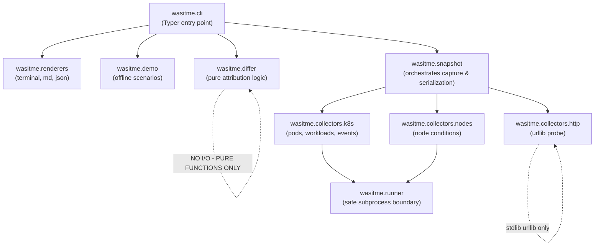

# System Specification — wasitme

**Document ID:** SPEC-001  
**Version:** 1.0 (Frozen at Gate 0)  
**Author:** Samritha (Solution Architect)  
**Approver:** Nithin K (Team Lead & Product Owner)  
**Status:** FROZEN  

---

## 1. Module Boundaries & Dependency Hierarchy

`wasitme` follows a strict unidirectional dependency architecture. Cyclic imports are prohibited.



### Dependency Rules:
1. **`differ.py` has NO I/O dependencies.** It imports only `models.py` (or dataclass contracts) and the standard library (`dataclasses`, `typing`). It never calls subprocesses, filesystem, network, or system clocks.
2. **`cli.py` contains wiring only.** No parsing or diffing logic resides in `cli.py`.
3. **`collectors/` never call `kubectl` directly.** All command execution flows through `runner.py`.
4. **`runner.py` never uses `shell=True`.** It invokes only allowlisted `kubectl get` commands.

---

## 2. Core Typed Interfaces

```python
from dataclasses import dataclass, field
from enum import Enum
from typing import Any, Dict, List, Optional, Protocol, Tuple

class IssueSeverity(str, Enum):
    ERROR = "error"
    WARNING = "warning"

class IssueKind(str, Enum):
    POD_CRASHLOOP = "POD_CRASHLOOP"
    POD_IMAGE_PULL = "POD_IMAGE_PULL"
    POD_OOMKILLED = "POD_OOMKILLED"
    POD_NOT_READY = "POD_NOT_READY"
    POD_PENDING = "POD_PENDING"
    RESTART_SPIKE = "RESTART_SPIKE"
    WORKLOAD_UNAVAILABLE = "WORKLOAD_UNAVAILABLE"
    NODE_NOT_READY = "NODE_NOT_READY"
    NODE_PRESSURE = "NODE_PRESSURE"
    WARNING_EVENT = "WARNING_EVENT"
    HTTP_DOWN = "HTTP_DOWN"
    HTTP_DEGRADED = "HTTP_DEGRADED"

class Bucket(str, Enum):
    BROKE_AFTER = "BROKE_AFTER"
    ALREADY_BROKEN = "ALREADY_BROKEN"
    FIXED = "FIXED"

@dataclass(frozen=True)
class Issue:
    key: str  # Deterministic composite key
    kind: IssueKind
    severity: IssueSeverity
    detail: str
    metrics: Dict[str, Any] = field(default_factory=dict)

@dataclass
class WorkloadSnapshot:
    namespace: str
    kind: str  # Deployment, StatefulSet, DaemonSet
    name: str
    desired: int
    available: int
    restarts_total: int

@dataclass
class PodSnapshot:
    namespace: str
    name: str
    owner_kind: str
    owner_name: str
    phase: str
    ready: bool
    restarts: int
    waiting_reason: Optional[str]
    last_terminated_reason: Optional[str]
    age_seconds: int

@dataclass
class NodeSnapshot:
    name: str
    ready: bool
    pressure: List[str]  # e.g. ["MemoryPressure"]

@dataclass
class EventSnapshot:
    namespace: str
    object: str  # Kind/name
    reason: str
    type: str    # "Warning"
    count: int
    last_seen: str

@dataclass
class HttpCheckSnapshot:
    name: str
    url: str  # Redacted
    samples: int
    ok_count: int
    status_mode: int
    p50_ms: float
    error: Optional[str]

@dataclass
class ClusterScope:
    context: str
    server: str
    namespaces: List[str]
    selector: Optional[str]

@dataclass
class Snapshot:
    schema_version: str
    tool_version: str
    taken_at: str  # ISO 8601 UTC
    cluster: ClusterScope
    workloads: List[WorkloadSnapshot]
    pods: List[PodSnapshot]
    nodes: List[NodeSnapshot]
    events: List[EventSnapshot]
    http_checks: List[HttpCheckSnapshot]
    issues: List[Issue]  # Derived at capture time

@dataclass
class DiffResult:
    verdict: str  # "REGRESSION_DETECTED" | "CLEAN" | "PREEXISTING_ISSUES_ONLY"
    broke_after: List[Issue]
    already_broken: List[Issue]
    fixed: List[Issue]
    baseline_taken_at: str
    current_taken_at: str
    exit_code: int

class Collector(Protocol):
    def collect(self, scope: ClusterScope) -> List[Any]:
        ...
```

---

## 3. Snapshot JSON Schema (Version 1.0)

```json
{
  "$schema": "https://json-schema.org/draft/2020-12/schema",
  "title": "WasItMeSnapshot",
  "type": "object",
  "required": [
    "schema_version",
    "tool_version",
    "taken_at",
    "cluster",
    "workloads",
    "pods",
    "nodes",
    "events",
    "http_checks",
    "issues"
  ],
  "properties": {
    "schema_version": { "type": "string", "enum": ["1.0"] },
    "tool_version": { "type": "string" },
    "taken_at": { "type": "string", "format": "date-time" },
    "cluster": {
      "type": "object",
      "required": ["context", "server", "namespaces", "selector"],
      "properties": {
        "context": { "type": "string" },
        "server": { "type": "string" },
        "namespaces": { "type": "array", "items": { "type": "string" } },
        "selector": { "type": ["string", "null"] }
      }
    },
    "workloads": {
      "type": "array",
      "items": {
        "type": "object",
        "required": ["namespace", "kind", "name", "desired", "available", "restarts_total"],
        "properties": {
          "namespace": { "type": "string" },
          "kind": { "type": "string" },
          "name": { "type": "string" },
          "desired": { "type": "integer" },
          "available": { "type": "integer" },
          "restarts_total": { "type": "integer" }
        }
      }
    },
    "pods": {
      "type": "array",
      "items": {
        "type": "object",
        "required": ["namespace", "name", "owner_kind", "owner_name", "phase", "ready", "restarts", "waiting_reason", "last_terminated_reason", "age_seconds"],
        "properties": {
          "namespace": { "type": "string" },
          "name": { "type": "string" },
          "owner_kind": { "type": "string" },
          "owner_name": { "type": "string" },
          "phase": { "type": "string" },
          "ready": { "type": "boolean" },
          "restarts": { "type": "integer" },
          "waiting_reason": { "type": ["string", "null"] },
          "last_terminated_reason": { "type": ["string", "null"] },
          "age_seconds": { "type": "integer" }
        }
      }
    },
    "nodes": {
      "type": "array",
      "items": {
        "type": "object",
        "required": ["name", "ready", "pressure"],
        "properties": {
          "name": { "type": "string" },
          "ready": { "type": "boolean" },
          "pressure": { "type": "array", "items": { "type": "string" } }
        }
      }
    },
    "events": {
      "type": "array",
      "items": {
        "type": "object",
        "required": ["namespace", "object", "reason", "type", "count", "last_seen"],
        "properties": {
          "namespace": { "type": "string" },
          "object": { "type": "string" },
          "reason": { "type": "string" },
          "type": { "type": "string" },
          "count": { "type": "integer" },
          "last_seen": { "type": "string" }
        }
      }
    },
    "http_checks": {
      "type": "array",
      "items": {
        "type": "object",
        "required": ["name", "url", "samples", "ok_count", "status_mode", "p50_ms", "error"],
        "properties": {
          "name": { "type": "string" },
          "url": { "type": "string" },
          "samples": { "type": "integer" },
          "ok_count": { "type": "integer" },
          "status_mode": { "type": "integer" },
          "p50_ms": { "type": "number" },
          "error": { "type": ["string", "null"] }
        }
      }
    },
    "issues": {
      "type": "array",
      "items": {
        "type": "object",
        "required": ["key", "kind", "severity", "detail", "metrics"],
        "properties": {
          "key": { "type": "string" },
          "kind": { "type": "string" },
          "severity": { "type": "string", "enum": ["error", "warning"] },
          "detail": { "type": "string" },
          "metrics": { "type": "object" }
        }
      }
    }
  }
}
```

### Schema Versioning Rules:
- **Minor Version Bump (e.g., 1.0 -> 1.1):** Additive, backwards-compatible field additions.
- **Major Version Bump (e.g., 1.0 -> 2.0):** Renaming, deleting, or altering the semantics of any required field.
- **Compatibility Guard:** `wasitme diff` checks major version equality. If `baseline.schema_version.split('.')[0] != current.schema_version.split('.')[0]`, it exits immediately with code `3`.

---

## 4. Exit Code & Error Taxonomy

| Exit Code | Classification | Cause / Trigger | User Action Message |
|---|---|---|---|
| **`0`** | Clean Success | No issues in `BROKE_AFTER` bucket | "Deploy verification successful. No regressions detected." |
| **`1`** | Regression Detected | At least 1 issue in `BROKE_AFTER` | "Regression detected after deployment. Review 'BROKE AFTER YOUR CHANGE' bucket." |
| **`2`** | Environment / Usage Error | `kubectl` not installed, auth failure, connection timeout, invalid CLI flag | "Error: <reason>. Verify kubectl is installed, cluster is reachable, and context is active." |
| **`3`** | Snapshot Incompatibility | JSON corrupt, file missing, or schema major version mismatch | "Error: Incompatible or invalid snapshot file. Re-take baseline using 'wasitme snapshot'." |

---

## 5. Architecture Decision Records (ADRs)

### ADR-001: Shelling Out to `kubectl get -o json` vs Kubernetes Python Client Library
- **Decision:** Shell out to system `kubectl` via `runner.py` using `subprocess.run`.
- **Status:** ACCEPTED.
- **Reason:** The official `kubernetes` Python client has massive transitive dependency trees (urllib3, cryptography, google-auth) which introduce frequent CVE churn and slow down execution. Shelling out to `kubectl` leverages existing user kubeconfigs, AWS IAM/EKS tokens, and SSO without any extra auth configuration.
- **Alternatives Rejected:**
  - `kubernetes` python client: Rejected due to heavy dependencies (>40MB wheel) and complex auth emulation.
  - Custom raw HTTP client against k8s API: Rejected due to necessity of implementing dozens of Kubernetes auth providers (exec, oidc, cloud-specific).

### ADR-002: Keying Pod & Workload Issues on Owner Hierarchy instead of Pod Name
- **Decision:** Pod issue keys MUST be formatted as `f"{kind}:{namespace}:{owner_kind}:{owner_name}"`. Pod names are never part of issue keys.
- **Status:** ACCEPTED.
- **Reason:** Every standard deployment rollout destroys old pods and spins up new ones with randomized hashes (e.g. `api-worker-6789f-ab12`). Keying by pod name causes all old issues to register as "FIXED" and all new issues to register as "BROKE AFTER", totally corrupting the attribution engine.
- **Alternatives Rejected:**
  - Raw pod name: Rejected because pod rotation causes 100% false positives/negatives.
  - Pod container image hash: Rejected because the deploy changes the image tag, breaking correlation.

### ADR-003: Pure Function, I/O-Free Differ Engine
- **Decision:** `wasitme.differ` must be a pure functional module taking two in-memory snapshot objects and returning a `DiffResult`.
- **Status:** ACCEPTED.
- **Reason:** Determinism. Given identical baseline and current snapshots, the diff output must be 100% reproducible regardless of current wall-clock time, environment variables, or host architecture. Enables fast, hermetic unit tests.
- **Alternatives Rejected:**
  - Differ performing live re-collection internally: Rejected because it breaks test isolation and makes edge-case property testing impossible.

### ADR-004: Standard Library `urllib` for HTTP Checks
- **Decision:** Use Python standard library `urllib.request` with 5 serial/threadpool samples, calculating p50 latency.
- **Status:** ACCEPTED.
- **Reason:** Preserves the hard constraint of keeping runtime dependencies limited to `typer` and `rich`. `urllib` handles SSL/TLS, timeouts, and HTTP status codes cleanly.
- **Alternatives Rejected:**
  - `httpx` or `requests`: Rejected because they introduce external runtime dependencies violating Section 1.3 constraints.

### ADR-005: Local JSON Snapshot Persistence vs Daemon/Database
- **Decision:** Baseline state stored exclusively in local JSON file (`.wasitme-snapshot.json` by default).
- **Status:** ACCEPTED.
- **Reason:** Zero infrastructure overhead. Can be checked into CI artifacts, ephemeral runners, or developer laptops without configuring external databases or state backends.
- **Alternatives Rejected:**
  - SQLite/PostgreSQL storage: Rejected as unnecessary complexity for point-to-point deploy comparisons.
  - Kubernetes ConfigMap storage: Rejected because it requires write/mutation permissions in the target cluster, violating read-only security invariants.

---

## 6. Risk Register

| Risk ID | Description | Impact | Likelihood | Mitigation |
|---|---|---|---|---|
| **RSK-01** | Pod ReplicaSet owner resolution failure (e.g., bare pod without deployment) | False regression reporting | Low | Graceful fallback: If no controller owner exists, key on `(kind, namespace, 'Pod', pod_name)`. |
| **RSK-02** | Cluster clock skew affecting warning event filtering | Events improperly excluded/included | Low | Parse event timestamps in ISO 8601 UTC and compare against snapshot `taken_at` with a 5-second grace window. |
| **RSK-03** | Rollout still in progress when `wasitme diff` is run | Transitory pod initialization flagged as error | Medium | Implement `--wait DURATION` and `--rollout KIND/NAME` settle checks. Flag mid-rollout pods as `UNSETTLED`. |
| **RSK-04** | Accidental leakage of secrets in snapshot JSON | Security vulnerability | High | Strict sanitizer: Redact container env values, ConfigMap values, and HTTP query strings/basic-auth userinfo before snapshot creation. |
| **RSK-05** | Flapping HTTP endpoint flipping diff verdict | Non-deterministic exit code | Medium | 5-sample probe requiring majority status consensus; p50 calculation to smooth single-sample latency spikes. |
